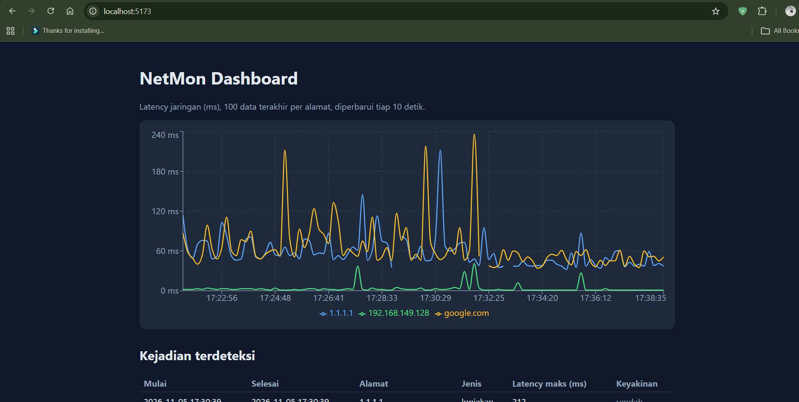
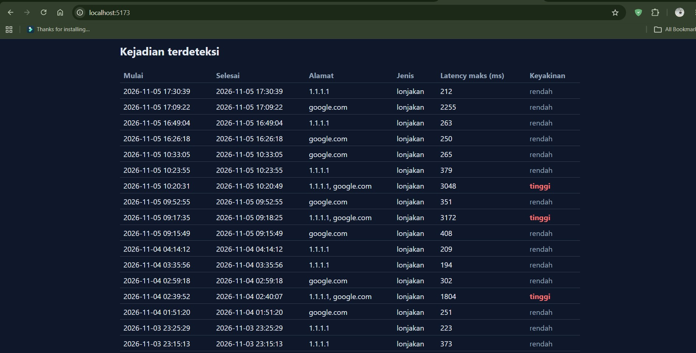
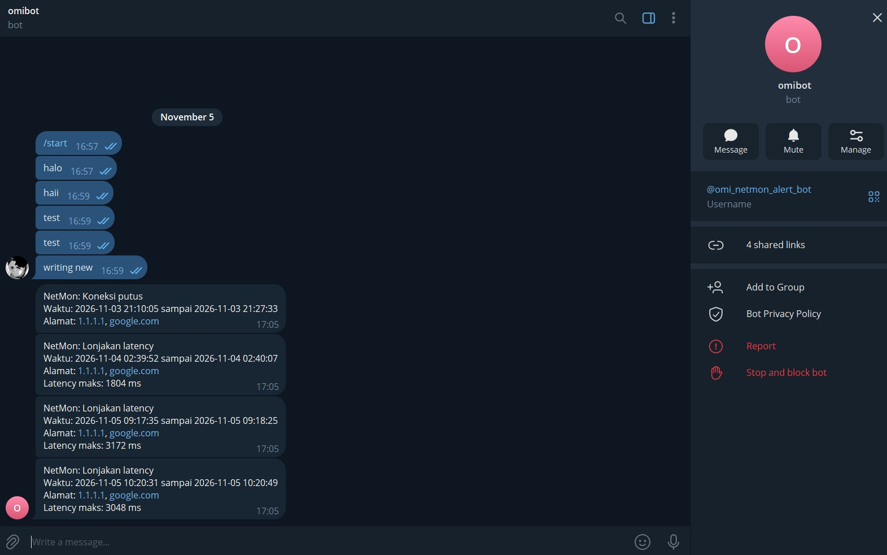
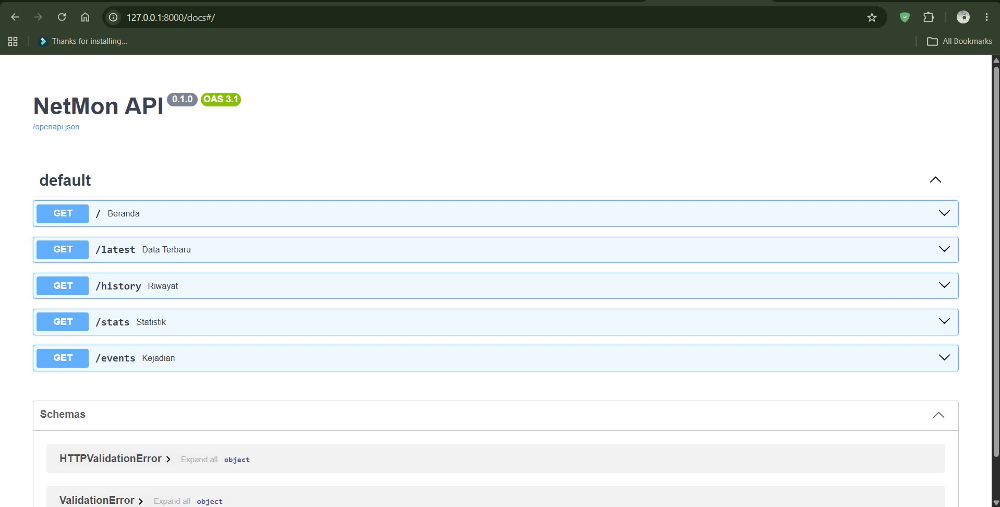
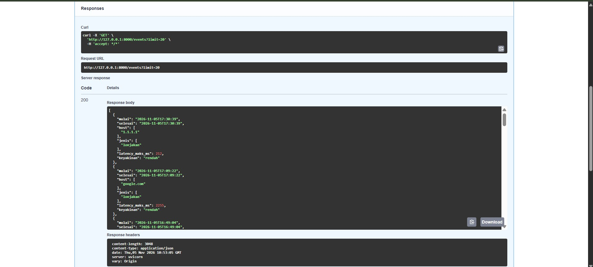
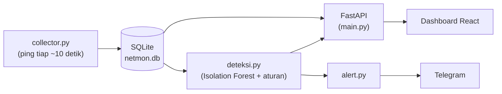
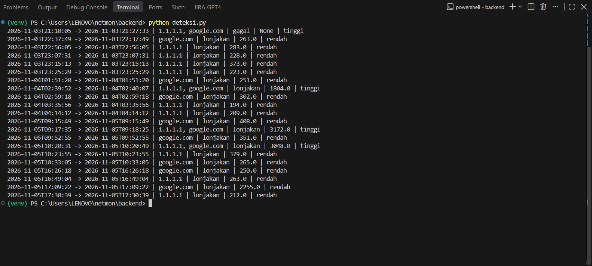

# NetMon

Sistem pemantau kualitas jaringan yang mengukur latency secara berkala, mendeteksi gangguan secara otomatis (lonjakan latency dan koneksi putus), menampilkannya di dashboard web, dan mengirim notifikasi Telegram.



## Latar belakang

Koneksi internet yang "kadang lambat" sulit dibuktikan karena gangguannya datang dan pergi. NetMon mencatat kondisi koneksi secara terus-menerus, sehingga setiap gangguan punya waktu, durasi, dan datanya.

Proyek ini juga dibangun sebagai latihan menggabungkan backend, frontend, jaringan, dan machine learning dalam satu sistem yang benar-benar berjalan, dengan seluruh tools gratis.

## Fitur

- Mengukur latency ke tiga target: `google.com`, `1.1.1.1`, dan gateway lokal (router atau hotspot), sekitar tiap 10 detik
- Menyimpan seluruh hasil pengukuran ke SQLite
- Dashboard: grafik latency, tabel kejadian, dan statistik per alamat
- Dua cara deteksi: lonjakan latency (Isolation Forest) dan koneksi putus (aturan ping gagal beruntun)
- Tingkat keyakinan kejadian: kejadian yang muncul di lebih dari satu alamat sekaligus ditandai **tinggi**
- Notifikasi Telegram untuk kejadian berkeyakinan tinggi, dengan pengiriman ulang otomatis bila koneksi sedang putus
- REST API dengan dokumentasi interaktif (Swagger)

## Tampilan

### Kejadian yang terdeteksi



### Notifikasi Telegram



### API (Swagger)



Contoh respons endpoint `/events`:



## Arsitektur



| Komponen | Tugas |
|---|---|
| `collector.py` | Menjalankan `ping` ke tiap target dan menyimpan hasilnya ke tabel `ping_log` |
| `main.py` | API FastAPI yang menyajikan data terbaru, riwayat, statistik, dan kejadian |
| `train.py` | Membuat fitur dan melatih satu model Isolation Forest per alamat |
| `deteksi.py` | Menggabungkan hasil model dan aturan menjadi daftar kejadian |
| `alert.py` | Memeriksa kejadian baru tiap 60 detik dan mengirimnya ke Telegram |
| `dashboard/` | Antarmuka web (React) yang mengambil data dari API |

## Cara kerja deteksi

1. **Pengumpulan.** Tiap target di-ping secara berkala. Gateway lokal ikut dipantau supaya masalah di jaringan sendiri bisa dibedakan dari masalah di internet.
2. **Fitur.** Untuk tiap alamat, dihitung rata-rata, simpangan baku, dan selisih latency terhadap jendela 6 data terakhir. Jendela dihitung per sesi: jeda lebih dari 60 detik (collector berhenti atau laptop mati) dianggap sesi baru, bukan gangguan.
3. **Dua aturan deteksi.**
   - *Lonjakan latency:* Isolation Forest menandai titik yang janggal, dan hanya yang latency-nya **lebih tinggi** dari rata-rata jendela yang dipakai.
   - *Koneksi putus:* minimal 3 ping gagal beruntun pada satu alamat. Ping gagal tidak punya nilai latency, sehingga ditangani dengan aturan, bukan model.
4. **Penggabungan.** Temuan yang berjarak 60 detik atau kurang digabung menjadi satu kejadian.
5. **Keyakinan.** Kejadian yang melibatkan dua alamat atau lebih ditandai **tinggi** (kemungkinan besar masalah ada di koneksi lokal). Kejadian di satu alamat saja ditandai **rendah** (umumnya jitter atau gangguan di jalur ke satu server).
6. **Alert.** Hanya kejadian berkeyakinan tinggi yang dikirim ke Telegram, sekali per kejadian. Jika pengiriman gagal (misalnya internet sedang putus), pengiriman diulang sampai berhasil.

## Hasil pengujian awal

Dari lebih dari 2.600 putaran pengukuran (3-5 November 2026), sistem menemukan empat kejadian berkeyakinan tinggi:

| Waktu | Jenis | Alamat terdampak | Puncak |
|---|---|---|---|
| 3 Nov 21:10 - 21:27 | Koneksi putus (sekitar 17,5 menit) | 1.1.1.1, google.com | - |
| 4 Nov 02:39 - 02:40 | Lonjakan latency | 1.1.1.1, google.com | 1804 ms |
| 5 Nov 09:17 - 09:18 | Lonjakan latency | 1.1.1.1, google.com | 3172 ms |
| 5 Nov 10:20 | Lonjakan latency | 1.1.1.1, google.com | 3048 ms |

Selain itu terdeteksi sejumlah lonjakan kecil (sekitar 190-410 ms) pada satu alamat saja. Semuanya berlabel rendah dan tidak dikirim sebagai alert.

## Teknologi

| Lapisan | Teknologi |
|---|---|
| Pengumpulan data | Python, perintah `ping` sistem, SQLite |
| Backend | FastAPI, Uvicorn |
| Machine learning | pandas, scikit-learn (Isolation Forest), joblib |
| Frontend | React (Vite), Recharts |
| Notifikasi | Telegram Bot API (requests, python-dotenv) |

## Struktur proyek

```
netmon/
├── backend/
│   ├── collector.py      # mengukur latency, menyimpan ke SQLite
│   ├── main.py           # API FastAPI
│   ├── train.py          # melatih model per alamat
│   ├── deteksi.py        # ML + aturan menjadi kejadian
│   ├── alert.py          # notifikasi Telegram
│   ├── cek_data.py       # alat bantu: sesi pengumpulan dan ping gagal
│   └── requirements.txt
├── dashboard/            # React (Vite) + Recharts
├── docs/                 # screenshot
├── jalankan_semua.bat    # menjalankan semua komponen (Windows)
└── README.md
```

## Cara menjalankan

### Prasyarat

- Python 3.9 atau lebih baru
- Node.js 18 atau lebih baru
- (Opsional, untuk alert) akun Telegram dan bot dari [@BotFather](https://t.me/BotFather)

### Instalasi

```bash
git clone https://github.com/USERNAME/netmon.git
cd netmon

# Backend
cd backend
python -m venv venv
venv\Scripts\activate        # Linux/macOS: source venv/bin/activate
pip install -r requirements.txt
cd ..

# Dashboard
cd dashboard
npm install
cd ..
```

### Konfigurasi

1. **Alamat gateway.** Jalankan `ipconfig`, lihat **Default Gateway** pada adapter Wi-Fi/Ethernet yang aktif, lalu ubah `TARGETS` di `backend/collector.py`:

   ```python
   TARGETS = ["google.com", "1.1.1.1", "ALAMAT_GATEWAY_KAMU"]
   ```

2. **Telegram (opsional).** Buat file `backend/.env`:

   ```
   TELEGRAM_TOKEN=token_dari_botfather
   TELEGRAM_CHAT_ID=chat_id_kamu
   ```

   Kirim pesan ke botmu lebih dulu, lalu buka `https://api.telegram.org/bot<TOKEN>/getUpdates` untuk melihat chat ID. File `.env` sudah masuk `.gitignore`, jangan pernah di-commit.

### Menjalankan

Di Windows, jalankan `jalankan_semua.bat`. File itu membuka empat jendela: collector, API, alert, dan dashboard. Lalu buka `http://localhost:5173`.



Atau jalankan manual di empat terminal terpisah:

```bash
# 1. Collector
cd backend && venv\Scripts\python.exe collector.py

# 2. API (dokumentasi di http://127.0.0.1:8000/docs)
cd backend && venv\Scripts\python.exe -m uvicorn main:app

# 3. Alert Telegram
cd backend && venv\Scripts\python.exe alert.py

# 4. Dashboard
cd dashboard && npm run dev
```

Saat pertama kali dijalankan, `alert.py` mengirim semua kejadian berkeyakinan tinggi yang sudah ada di database (satu kali saja), lalu hanya kejadian baru.

### Melatih model

Biarkan collector berjalan beberapa jam sampai beberapa hari, lalu:

```bash
cd backend
python train.py
```

Perintah ini membuat file `model_<alamat>.joblib` untuk tiap alamat. Tanpa model, hanya deteksi koneksi putus yang aktif. Latih ulang setelah datanya bertambah banyak atau setelah mengganti target.

## Endpoint API

| Endpoint | Fungsi |
|---|---|
| `GET /` | Memastikan API berjalan |
| `GET /latest` | Data terbaru untuk tiap alamat |
| `GET /history?host=...&limit=100` | Riwayat latency satu alamat (maksimal 2000 data) |
| `GET /stats` | Statistik per alamat: rata-rata, minimum, maksimum, persen gagal |
| `GET /events?limit=20` | Kejadian terdeteksi, terbaru lebih dulu |

## Keterbatasan

- Model dilatih pada data beberapa jam, jadi belum mencakup pola harian atau mingguan.
- Evaluasi masih memakai data yang sama dengan data latih, belum ada pemisahan data uji.
- Pengaturan `contamination=0.01` membuat model selalu menandai sekitar 1% data. Karena itu keyakinan antar-alamat dipakai untuk menyaring kejadian yang layak dikirim sebagai alert.
- Alamat gateway masih diisi manual dan perlu diganti saat pindah jaringan.
- Berjalan di satu laptop: saat laptop mati atau tidur, tidak ada data yang terekam (celahnya dipisahkan sebagai sesi tersendiri).
- `/events` dihitung ulang setiap dipanggil dan belum di-cache.
- API tidak memiliki autentikasi karena ditujukan untuk penggunaan lokal.
- `jalankan_semua.bat` hanya untuk Windows.

## Rencana pengembangan

- Mendeteksi alamat gateway secara otomatis
- Melatih ulang model dengan data beberapa hari dan mengevaluasinya pada data uji terpisah
- Menandai kejadian langsung di grafik dashboard
- Menyimpan hasil deteksi (cache) agar `/events` lebih ringan
- Deploy

## Pembuat

Dibuat oleh [MeetRifa](https://github.com/CutRifa).